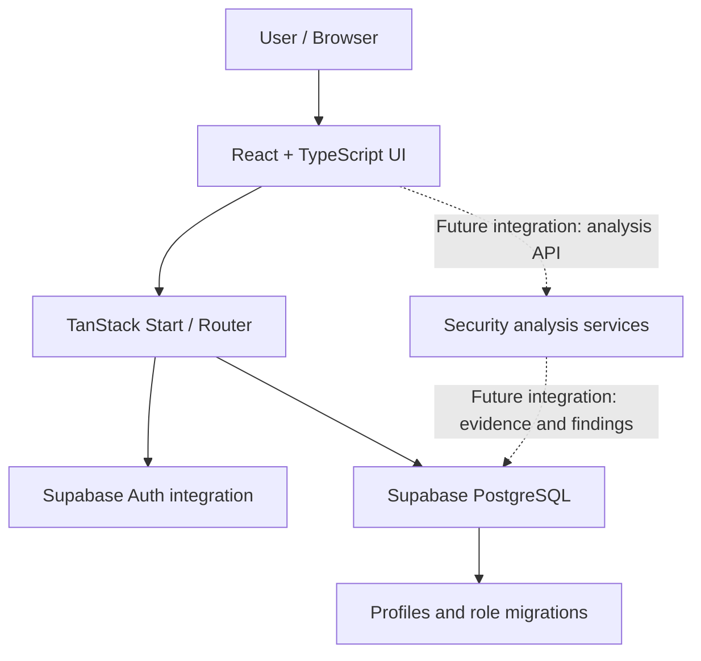

<div align="center">

# 🛡️ Rakshak AI

### India's Personal Cyber Guardian

**A security-awareness web application concept for examining suspicious links, QR codes, websites, mobile apps, and messages.**

[](https://idris4hack.lovable.app)
[](https://www.typescriptlang.org/)
[](https://react.dev/)
[](https://supabase.com/)

<br />


*Built by [IDRIS4HACK](https://github.com/)*

</div>

---

## Overview

Rakshak AI is a web application project focused on making digital-risk signals easier to understand. Its interface brings common scam-checking workflows into one place and is designed around clear explanations, risk awareness, and practical next steps.

The current repository contains the frontend application, Supabase client integration, authentication flows, UI routes, and database migrations for user profiles and roles. Some security-analysis screens are currently interface scaffolding; they should not be treated as a production scanner until their analysis services and end-to-end flows are implemented and tested.

## Product areas

| Area | Current repository status |
| --- | --- |
| Public landing page, feature overview, pricing page | UI implemented |
| Sign-in and sign-up screens | Supabase Auth integration present; configure and test against your own project |
| Auth-protected dashboard and account pages | UI routes present; verify data flows before production use |
| URL, QR, website, APK, and message scan center | Interface scaffolding; analysis actions need implementation/verification |
| Threat intelligence and reports | UI routes present; verify data sources and persistence |
| Profiles and role model | SQL migrations included for profiles and role records |
| Risk scoring, live threat feeds, APK inspection, QR redirect analysis | Not verified as working in this source archive |

> **Project status:** Portfolio / development project. Do not rely on it as a production security product or use its current UI alone to decide whether a link, file, or message is safe.

## Why this project?

- **One place for common scam-checking workflows** rather than separate tools for every input type.
- **Explainable results as a design goal** — present evidence and recommended actions, not only a label.
- **Security-conscious foundation** with Supabase authentication integration and database row-level security policies in the supplied migrations.
- **A clear path to extend** the interface with tested analysis services, auditable findings, and report exports.

## Technology stack

- **React 19 + TypeScript**
- **TanStack Start** and **TanStack Router** for application routing and server rendering
- **Tailwind CSS v4** for styling
- **shadcn/ui and Radix UI** component primitives
- **TanStack Query** for data-fetching patterns
- **Supabase** client integration for authentication and PostgreSQL-backed profile/role data
- **Recharts** for dashboard visualizations
- **Vite** for development and build tooling

## Architecture at a glance



The dashed connections represent planned integration points, not confirmed working scan services.

## Repository layout

```text
rakshak-ai/
├── public/                       # Static public assets
├── src/
│   ├── assets/                   # App artwork
│   ├── components/               # Brand, layout, account and UI components
│   ├── hooks/                    # Shared React hooks
│   ├── integrations/
│   │   ├── lovable/              # Lovable OAuth integration
│   │   └── supabase/             # Supabase clients, auth helpers and types
│   ├── lib/                      # Shared utilities and error handling
│   ├── routes/                   # Public and authenticated routes
│   ├── router.tsx
│   ├── server.ts
│   └── start.ts
├── supabase/
│   ├── migrations/               # SQL schema and policy migrations
│   └── config.toml
├── .env.example                  # Safe environment-variable template
├── .gitignore
├── package.json
└── README.md
```

## Getting started

### Prerequisites

- Node.js version compatible with the project dependencies (use a current LTS release)
- Bun (recommended because this repository includes `bun.lock`), or npm
- A Supabase project if you want to test authentication and database integration

### 1. Clone the repository

Replace `YOUR-USERNAME` with your GitHub username:

```bash
git clone https://github.com/YOUR-USERNAME/rakshak-ai.git
cd rakshak-ai
```

### 2. Install dependencies

**Using Bun (recommended):**

```bash
bun install --frozen-lockfile
```

**Or using npm:**

```bash
npm install
```

If you use npm, keep dependency changes and the lockfile consistent with the package manager you choose.

### 3. Configure environment variables

Create a local environment file from the example:

```bash
cp .env.example .env
```

Fill in the values from your own Supabase project settings. Never commit `.env`.

| Variable | Purpose |
| --- | --- |
| `SUPABASE_URL` | Supabase project URL, used by server-side code |
| `SUPABASE_PUBLISHABLE_KEY` | Supabase publishable key |
| `SUPABASE_PROJECT_ID` | Supabase project identifier |
| `VITE_SUPABASE_URL` | Project URL exposed to the frontend build |
| `VITE_SUPABASE_PUBLISHABLE_KEY` | Publishable key used by the frontend |
| `VITE_SUPABASE_PROJECT_ID` | Project identifier used by frontend tooling |
| `SUPABASE_SERVICE_ROLE_KEY` | Optional server-only administrative key; never expose it to browser code or commit it |

Only use publishable/anon keys in browser code. A Supabase service-role or secret key bypasses important access controls and must remain server-side. Review Supabase Row Level Security policies before connecting real user data.

### 4. Start the development server

```bash
bun run dev
```

Or with npm:

```bash
npm run dev
```

Open the local URL printed in your terminal (the project configuration may use port `8080`).

### 5. Run quality checks

```bash
bun run lint
bun run build
```

Or:

```bash
npm run lint
npm run build
```

These commands are documented for local verification; run them in your environment and resolve any errors before deploying. A successful frontend build does not prove that authentication, database policies, or security-analysis workflows work end to end.

## Supabase setup notes

The `supabase/migrations/` directory contains SQL for the `profiles` table, `user_roles` table, role helper function, signup trigger, and associated policies. Review the migrations before applying them to any database.

1. Create or select the correct Supabase project.
2. Configure the environment variables locally.
3. Review the SQL and RLS policies.
4. Apply migrations using your chosen Supabase workflow.
5. Configure authentication providers and allowed redirect URLs.
6. Test sign-up, email confirmation, sign-in, sign-out, and access restrictions.

The archive's migration files do not include a database backup or user records. Connecting this repository to a different Supabase project does not migrate existing data.

## Security checklist

Before making this repository public:

- [ ] Confirm `.env` and all local environment files are excluded.
- [ ] Search for API keys, tokens, passwords, private keys, service-role keys, and customer data.
- [ ] Rotate any credential that was accidentally exposed in a public repository.
- [ ] Review every Supabase RLS policy and test with an ordinary authenticated user.
- [ ] Keep administrative operations on the server; never bundle service-role keys into frontend code.
- [ ] Do not upload real malicious files or sensitive scan submissions as examples.
- [ ] Do not describe unimplemented analysis flows as working security controls.

See [SECURITY.md](SECURITY.md) for responsible reporting guidance.

## Roadmap

- [ ] Connect scan forms to validated backend analysis endpoints.
- [ ] Implement and test URL and domain reputation checks.
- [ ] Add safe QR decoding and redirect analysis.
- [ ] Add static APK metadata and permission analysis in an isolated workflow.
- [ ] Persist findings and scan history with strict authorization policies.
- [ ] Add explainable risk scoring with evidence and confidence.
- [ ] Export structured JSON and human-readable reports.
- [ ] Add automated tests and CI checks.
- [ ] Add screenshots of verified end-to-end workflows.

## Contributing

Suggestions, bug reports, and improvements are welcome. Please read [CONTRIBUTING.md](CONTRIBUTING.md), avoid including secrets in issues or pull requests, and clearly distinguish implemented behavior from proposals.

## Responsible use

Rakshak AI is intended for cybersecurity awareness, defensive analysis, and authorized testing. Only submit data you have permission to analyze. Do not use the project to access systems without authorization, and do not treat automated output as a guarantee that content is safe or malicious.

## License

No open-source license has been selected for this repository yet. Unless a license is added by the owner, normal copyright restrictions apply. Do not assume the code is available for reuse, modification, or redistribution.

---

<div align="center">

**Rakshak AI — making digital risks easier to understand.**

</div>
